# WoWiki

[](https://github.com/Arvence/WoWiki/actions/workflows/ci.yml)

WoWiki is a modular World of Warcraft Classic platform built with a React frontend, a NestJS content and game-data API, ASP.NET Core services, and a YARP gateway. User content reports are delivered to the [TaskForge](https://github.com/Arvence/TaskForge) background job processor over a private server-to-server integration.

## Local architecture

The browser uses one origin: `http://localhost:8080`.

[](docs/request-response-map.md)

| Public path | Destination |
| --- | --- |
| `/` | React frontend on port `3000` |
| `/api/auth/*` | Auth service on port `5100` |
| `/api/pdf/*` | PDF service on port `5200` |
| `/api/*` | NestJS backend on port `5000` |
| `/images/*` | NestJS backend on port `5000` |
| `/gateway/health` | Gateway health |

The frontend only uses relative application URLs. Internal ports remain implementation details behind the gateway.
Protected NestJS operations forward the session cookie and correlation ID to the Auth service;
the gateway-forwarded client address keeps authentication limits partitioned per browser.
Mutable backend content and game data persist in `backend/Data/wowiki-backend.db`;
the Auth service keeps identity data in its separate SQLite database.

The repository ships with a versioned demo database. Install it into the active
backend database before starting the server:

```powershell
cd backend
npm run db:demo
```

Stop the backend and run `npm run db:clear` to remove the active local database.
The committed demo template remains unchanged and can be installed again at any
time.

See the [gateway-first request/response map](docs/request-response-map.md) for
end-to-end flows, endpoint access levels, propagated headers, response shapes,
and service ownership.

## Run locally

Install the root and application dependencies once, then start the full local
environment from the repository root:

```powershell
npm ci
npm ci --prefix backend
npm ci --prefix frontend
npm run start:all
```

This starts NestJS and Vite with hot reload plus Auth, PDF, and the gateway on
their existing ports. Logs are labeled by service in the same terminal. Press
Ctrl+C to stop the entire group; if one service exits, the others stop too.
Local storage uses SQLite, so Docker is not required. Existing data is preserved.

Use `npm run start:backend` or `npm run start:frontend` from the root to run either
application independently. `start:auth`, `start:pdf`, and `start:gateway` are also
available individually. The existing application-level commands still work:

```powershell
cd backend
npm run dev
```

```powershell
cd frontend
npm run dev
```

```powershell
cd services/auth
dotnet run --project src/WoWiki.Auth.Api
```

```powershell
cd services/pdf
dotnet run --project src/WoWiki.Pdf.Api
```

```powershell
cd services/gateway
dotnet run --project src/WoWiki.Gateway -- --environment Development
```

Open `http://localhost:8080`.

TaskForge is optional for general browsing but required for asynchronous
user-report delivery. Run TaskForge separately on its default
`http://localhost:8275` address before testing the report workflow. See
[TaskForge user-report integration](docs/taskforge-user-reports.md) for the
network boundary and configuration.

## Portfolio browser tests

On Windows with Node.js 24 and the .NET 10 SDK, install dependencies in the root,
`backend`, and `frontend`, then run:

```powershell
npx playwright install chromium
npm run test:e2e
```

The six focused Playwright journeys use real Auth, NestJS, Vite, and gateway
processes on isolated ports `15100`, `15000`, `13000`, and `18080`. Each run builds
the services, copies the demo content into a temporary database, creates a fresh
identity database, and removes both after shutdown. Your development databases
and running services are preserved. PDF and TaskForge are outside this suite's
scope. Failures save screenshots and traces under `test-results/`.

## Repository structure

```text
frontend/          React user interface
backend/           NestJS content and canonical game-data API
services/auth/     ASP.NET Core identity service
services/pdf/      ASP.NET Core PDF generation service
services/gateway/  YARP public entry point and request routing
```

The gateway is the required browser entry point. Vite serves frontend assets internally and does not proxy application APIs.
Gateway API routes include per-client rate limiting, correlation IDs, baseline security headers, request hardening, and structured request logging.
Content and game-data reads are public. Mutations require an authenticated moderator or admin,
while community creation, comments, and reactions require an authenticated user.

## License

Original WoWiki code and materials are licensed under the [MIT License](LICENSE). World of Warcraft and other third-party content are excluded; see the [intellectual property notice](NOTICE.md).
