# WoWiki

[](https://github.com/Arvence/WoWiki/actions/workflows/ci.yml)

WoWiki is a modular World of Warcraft Classic platform built with a React frontend, a NestJS content and game-data API, ASP.NET Core services, and a YARP gateway. The NestJS backend saves user content reports in SQLite.

WoWiki has completed its intended portfolio scope and is in maintenance mode.
Maintenance covers bug fixes, security updates, necessary dependency updates,
and minor asset and documentation updates.

## Local architecture

The browser uses one origin: `http://localhost:8080`.

[](docs/request-response-map.md)

| Public path | Destination |
| --- | --- |
| `/` | React frontend on port `3000` |
| `/api/auth/*` | Auth service on port `5100` |
| `/api/pdf/*` | PDF service on port `5200` |
| `/api/*` | NestJS backend on port `5000` |
| `/images/*` | NestJS backend on port `5000` |
| `/gateway/health` | Gateway health |

The frontend only uses relative application URLs. Internal ports remain implementation details behind the gateway.
Protected NestJS operations forward the session cookie and correlation ID to the Auth service;
the gateway-forwarded client address keeps authentication limits partitioned per browser.
Mutable backend content and game data persist in `backend/Data/wowiki-backend.db`;
the Auth service keeps identity data in its separate SQLite database.

A fresh backend database automatically loads starter News, community entries,
and game records, including items. Subsequent starts preserve local changes.
The optional [archived demo snapshot](backend/README.md#archived-demo-database)
contains a different set of records. `db:demo` replaces the active backend
database and `db:clear` deletes it. Stop the backend and back up the active
database before using either command.

See the [gateway-first request/response map](docs/request-response-map.md) for
end-to-end flows, endpoint access levels, propagated headers, response shapes,
and service ownership.

## Run locally

Use Windows, Node.js 24, and the .NET 10 SDK. Install the root and application
dependencies from their lockfiles, then start the full local environment from
the repository root:

```powershell
npm ci
npm ci --prefix backend
npm ci --prefix frontend
npm run start:all
```

This starts NestJS and Vite with hot reload plus Auth, PDF, and the gateway on
their existing ports. Logs are labeled by service in the same terminal. Press
Ctrl+C to stop the entire group; if one service exits, the others stop too.
The core WoWiki services use SQLite and can run without Docker. Existing data is preserved.

Use `npm run start:backend` or `npm run start:frontend` from the root to run either
application independently. `start:auth`, `start:pdf`, and `start:gateway` are also
available individually. The existing application-level commands still work:

```powershell
cd backend
npm run dev
```

```powershell
cd frontend
npm run dev
```

```powershell
cd services/auth
dotnet run --project src/WoWiki.Auth.Api
```

```powershell
cd services/pdf
dotnet run --project src/WoWiki.Pdf.Api
```

```powershell
cd services/gateway
dotnet run --project src/WoWiki.Gateway -- --environment Development
```

Open `http://localhost:8080`.

For scheduled News publishing, run TaskForge separately and set these environment
variables before starting WoWiki's NestJS backend, including when you use `npm run start:all`:

- `TASKFORGE_URL` is the TaskForge Server base URL, for example `http://127.0.0.1:8275` for a local instance on that port.
- `TASKFORGE_API_KEY` is the application API key for `wowiki`. Keep it in the backend process environment.

The News Editor checks TaskForge API readiness. The publishing worker runs inside
the configured NestJS backend. Draft editing and Publish Now also work without TaskForge.
New accounts have the `user` role. To see the moderator workflow with a disposable
account and database, run the [browser journey for the News Editor](tests/e2e/portfolio.spec.ts).
The test assigns the existing moderator role only in its temporary identity database.

## Portfolio browser tests

On Windows with Node.js 24 and the .NET 10 SDK, install dependencies in the root,
`backend`, and `frontend`, then run:

```powershell
npx playwright install chromium
npm run test:e2e
```

The Playwright journeys use real Auth, NestJS, Vite, and gateway
processes on isolated ports `15100`, `15000`, `13000`, and `18080`. Each run builds
the services and creates fresh content and identity databases in a temporary
directory. The backend loads the same starter content as a first local launch.
Both databases are removed after shutdown. Your development databases
and running services are preserved. PDF is outside this suite's scope.
Failures save screenshots and traces under `test-results/`.

## Repository structure

```text
frontend/          React user interface
backend/           NestJS content and canonical game-data API
services/auth/     ASP.NET Core identity service
services/pdf/      ASP.NET Core PDF generation service
services/gateway/  YARP public entry point and request routing
```

Use the gateway for the full application. When opening Vite directly for development,
Vite proxies `/api/auth/*` to the Auth service and `/api/*` and `/images/*` to NestJS.
Use the gateway for `/api/pdf/*`.
Gateway API routes include per-client rate limiting, correlation IDs, baseline security headers, request hardening, and structured request logging.
Content and game-data reads are public. Mutations require an authenticated moderator or admin,
while community creation, comments, and reactions require an authenticated user.

## License

Original WoWiki code and materials are licensed under the [MIT License](LICENSE). World of Warcraft and other third-party content are excluded; see the [intellectual property notice](NOTICE.md).
